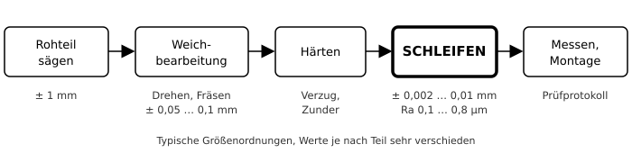

# 1 Warum schleifen?

Lernziel · 3 Einheiten

Nach diesem Kapitel kannst du erklären, wo das Schleifen in der Fertigung steht und warum ein Kunde dafür eine teure Maschine kauft. Du liest Maß-, Form- und Lagetoleranzen und Rauheitswerte auf einer Zeichnung und schätzt ein, ob ein Teil geschliffen werden muss.

Ein Fall aus deinem künftigen Gebiet

Ein Werkzeugbauer bei Stuttgart baut Stanzwerkzeuge. Seine Schnittplatten aus Werkzeugstahl werden gefräst und dann auf 60 HRC gehärtet. Beim Härten verziehen sie sich um einige Hundertstel. Gefordert sind aber **0,003 mm Ebenheit**. Ein Fräser schafft das am gehärteten Teil nicht wirtschaftlich. Also schleift er, und genau hier kommst du ins Spiel.

## 1.1 Die Fertigungskette

Schleifen steht fast immer **am Ende** der Kette. Das hat drei Gründe:

1. **Härte.** Nach dem Härten ist Stahl zu hart für viele Fräs- und Drehwerkzeuge. Schleifkörner aus Korund oder CBN sind härter als der Stahl.
2. **Genauigkeit.** Schleifen nimmt nur sehr wenig ab, oft Hundertstel bis wenige Zehntel Millimeter. So erreicht es Toleranzen von wenigen Mikrometern.
3. **Oberfläche.** Viele kleine Schneiden erzeugen eine feine Oberfläche, wie sie Dichtflächen, Gleitflächen und Formteile brauchen.

Merksatz

Schleifen ist **Spanen mit geometrisch unbestimmter Schneide**: Viele harte Körner mit zufälliger Form nehmen winzige Späne ab. Man schleift, wenn ein Teil **hart**, **genau** oder **fein** sein muss. Meistens trifft alles drei zu.

[[LINIEN 3]]

## 1.2 Wie klein ist ein Mikrometer?

1 µm = 0,001 mm. Ein menschliches Haar ist etwa 50–100 µm dick. Wenn dein Kunde „zwei µ“ sagt, meint er also ungefähr ein Vierzigstel eines Haares.

| Angabe | in mm | in µm |
|---|---|---|
| ein Zehntel | 0,1 mm | 100 µm |
| ein Hundertstel | 0,01 mm | 10 µm |
| ein Tausendstel („ein µ“) | 0,001 mm | 1 µm |

## 1.3 Maßtoleranzen

Eine Maßtoleranz sagt, wie weit ein Maß vom Nennmaß abweichen darf. Für Wellen und Bohrungen gibt es die ISO-Toleranzgrade **IT** (ISO 286): Je kleiner die Zahl, desto enger ist die Toleranz.

| Nennmaß 30 bis 50 mm | IT5 | IT6 | IT7 | IT8 |
|---|---|---|---|---|
| Toleranzfeld | 11 µm | 16 µm | 25 µm | 39 µm |
| typisch erreicht durch | Schleifen | Schleifen | Feindrehen, Schleifen | Drehen, Reiben |

Beispiel: **Ø 40 h6** ist eine Welle. „h“ heißt, das obere Abmaß ist 0. „6“ ergibt 16 µm. Die Welle muss also zwischen 39,984 mm und 40,000 mm liegen.

## 1.4 Form- und Lagetoleranzen

Für dich als Flachschleif-Verkäufer sind vor allem **Ebenheit** und **Parallelität** wichtig, dazu Rechtwinkligkeit. Beim Rundschleifen kommen Rundheit, Zylinderform und Rundlauf dazu.

Merksatz

**Ebenheit** ist eine Formtoleranz und braucht **keinen Bezug**. **Parallelität** ist eine Lagetoleranz und braucht **immer einen Bezug** (z. B. A). Eine Maschine, die schön eben schleift, ist noch lange nicht parallel. Dafür muss auch die Aufspannung stimmen.

[[LINIEN 3]]

Zeichnen · Aufgabe 1.1

Zeichne einen Quader (Seitenansicht). Trag an der Oberseite eine Ebenheit von 0,003 mm ein. Trag außerdem eine Parallelität von 0,005 mm zur Unterseite ein und kennzeichne die Unterseite als Bezug A.

[[FELD 55]]

## 1.5 Rauheit: Ra und Rz

- **Ra** ist der arithmetische Mittenrauwert, also die mittlere Abweichung des Profils von der Mittellinie. Ra ist der Wert, den du am häufigsten auf Zeichnungen siehst.
- **Rz** ist die gemittelte Rautiefe. Man nimmt den größten Abstand zwischen Spitze und Tal in fünf Einzelstrecken und bildet daraus den Mittelwert. Rz reagiert stärker auf einzelne Riefen.
- Faustregel: **Rz ist ungefähr 4- bis 7-mal so groß wie Ra.** Das ist nur ein grober Richtwert, keine Umrechnung.

| Verfahren | Ra typisch (Richtwerte) |
|---|---|
| Fräsen, Drehen | 0,8 – 3,2 µm |
| Schleifen | 0,1 – 0,8 µm |
| Läppen, Polieren | unter 0,1 µm |

Rechnen · Aufgaben 1.2 bis 1.5

**1.2** Eine Leiste soll 25 ± 0,004 mm dick sein. Wie groß ist das Toleranzfeld in µm?

**1.3** Eine Welle Ø 40 h7. Gib das kleinste und das größte erlaubte Maß an (Tabelle oben).

**1.4** Rechne um: 0,0025 mm = ___ µm, 12 µm = ___ mm.

**1.5** Auf der Zeichnung steht Ra 0,4. Grob geschätzt: Welcher Rz-Wert ist zu erwarten?

[[KARO 45]]

Erst schätzen, dann prüfen · Aufgabe 1.6

Eine geschliffene Fläche glänzt matt-silbern. Eine geläppte Fläche spiegelt. Schreib deine Vermutung auf: Um welchen Faktor ungefähr unterscheiden sich die Ra-Werte? Prüfe sie danach mit der Tabelle.

Meine Vermutung: ________________ · Tabelle sagt: ________________

Transfer · Aufgabe 1.7 – Zeichnung lesen

Ein Kunde schickt dir diese Angaben: **Schnittplatte 200 × 100 × 20 mm, Werkstoff 1.2379, gehärtet 60 HRC, Ebenheit 0,003 mm, Parallelität 0,005 mm zu A, Ra 0,4 µm, Dicke 20 ± 0,01 mm.**

a) Welche Angaben machen Schleifen nötig? Begründe sie einzeln.

b) Welche Angabe ist für die Maschinenwahl am kritischsten?

[[LINIEN 6]]

Laut sprechen · Aufgabe 1.8 (60 Sekunden)

Ein Einkäufer fragt: „Warum können wir die Platten nicht einfach fräsen? Das ist billiger.“ Erkläre es ihm in 60 Sekunden, ohne Fachchinesisch. Sprich mindestens zweimal und stoppe die Zeit.

Fachbegriffe Deutsch – Englisch

| Deutsch | Englisch | Deutsch | Englisch |
|---|---|---|---|
| Schleifen | grinding | Ebenheit | flatness |
| Toleranz | tolerance | Parallelität | parallelism |
| Nennmaß | nominal size | Rechtwinkligkeit | squareness / perpendicularity |
| Aufmaß | stock allowance | Rauheit | surface roughness |
| gehärtet | hardened | Bezug | datum |

Kurztest Kapitel 1

1. Nenne drei Gründe, warum ein Teil geschliffen wird.
2. Wie viele µm hat ein Hundertstel?
3. Was ist der Unterschied zwischen Ebenheit und Parallelität?
4. Was bedeutet „h6“ bei einer Welle?
5. Welcher Wert reagiert stärker auf eine einzelne tiefe Riefe: Ra oder Rz?
6. Warum steht Schleifen meist nach dem Härten?

[[LINIEN 8]]

Wiederholen am: __________ (morgen) · __________ (in 1 Woche) · __________ (in 1 Monat)
