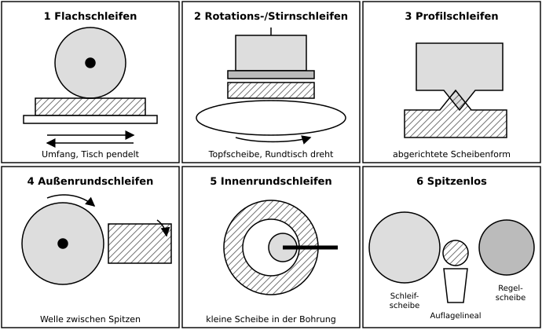

# 2 Die Schleifverfahren

Lernziel · 3 Einheiten

Du unterscheidest die wichtigsten Schleifverfahren und ordnest einem Werkstück das passende Verfahren und die passende Maschinenart zu. Du weißt, welche Okamoto-Baureihe zu welchem Verfahren gehört.

Warum das wichtig ist

Kunden fragen selten „Ich brauche eine Flachschleifmaschine“. Meistens zeigen sie dir ein Teil und fragen: „Wie bekomme ich das genauer und schneller hin?“ Du musst das Teil anschauen und sofort das Verfahren dazu im Kopf haben.

## 2.1 Drei Fragen ordnen alle Verfahren

1. **Welche Fläche?** Eine ebene Fläche bedeutet Flachschleifen (Planschleifen), eine runde Fläche Rundschleifen (außen oder innen), eine geformte Fläche Profilschleifen.
2. **Mit welcher Seite der Scheibe?** Beim **Umfangsschleifen** arbeitet der Umfang der Scheibe, beim **Seiten- oder Stirnschleifen** die Stirnseite, z. B. bei einer Topfscheibe.
3. **Wie wird zugestellt?** Beim **Pendelschleifen** gibt es viele schnelle Hübe mit kleiner Zustellung. Beim **Tiefschleifen** (creep feed) gibt es einen langsamen Durchgang mit großer Zustellung. Beim **Einstechschleifen** fährt die Scheibe ohne Längsvorschub ins Werkstück.

## 2.2 Die Verfahren im Überblick

| Verfahren | Typische Teile | Okamoto (Beispiele) |
|---|---|---|
| **Flachschleifen** | Platten, Leisten, Stempel, Formplatten | ACC-GX, ACC-SA1, ACC-CA-iQ |
| **Flachschleifen groß / Portal** | Formaufbauten, Führungsbahnen, lange Leisten | ACC-CHNC, ACC-CHiQ |
| **Profilschleifen** | Stanzstempel, Nuten, Führungsprofile | CNC-Flach- und Portalmaschinen mit Profilabrichten |
| **Rotationsschleifen** | Dichtringe, Scheiben, Ventilplatten | PRG-iQ |
| **Außenrundschleifen** | Wellen, Bolzen, Lagersitze | OGM-Reihe |
| **Innenrundschleifen** | Bohrungen in Zahnrädern, Lagerringen, Buchsen | IGM-Reihe |
| **Spitzenlosschleifen** | Bolzen, Stifte in großen Stückzahlen | (im Programm prüfen) |
| **Wafer-, Läpp-, Polierprozesse** | Silizium-Wafer, SiC, Saphir | Halbleiter-Sparte (z. B. GNX) |

Okamoto-Zuordnung nach Herstellerangaben und Fachpresse, siehe QUELLEN.md. Das Europa-Programm prüfst du in Kapitel 7.

Merksatz

**Flach** heißt ebene Fläche, **rund** heißt Welle oder Bohrung, **Profil** heißt geformte Scheibe. **Pendeln** bedeutet schnell und flach, **tief** bedeutet langsam und tief. Okamotos Kerngeschäft ist das **Flachschleifen**. Dort ist der Hersteller am stärksten.

[[LINIEN 4]]

## 2.3 Pendel- oder Tiefschleifen?

| | Pendelschleifen | Tiefschleifen |
|---|---|---|
| Zustellung pro Hub | klein (Hundertstel) | groß (Millimeter) |
| Tischgeschwindigkeit | schnell (m/min) | langsam (mm/min) |
| Stärke | einfach, flexibel, gute Ebenheit | viel Abtrag in einem Durchgang, Profile aus dem Vollen |
| Maschine | Standard-Flachschleifmaschine | steife Maschine, viel Leistung, viel Kühlschmierstoff |

## 2.4 Kontaktlänge: ein Gefühl für die Zone, in der geschliffen wird

Die **Kontaktlänge** ist die Strecke, auf der Scheibe und Werkstück gleichzeitig Kontakt haben. Je länger sie ist, desto mehr Wärme entsteht dort und desto schwerer kommt der Kühlschmierstoff hin.

Erst schätzen, dann prüfen · Aufgabe 2.1

Gleiche Scheibe (Ø 125 mm), gleiche Zustellung, drei Verfahren: Flachschleifen, Außenrundschleifen einer Welle Ø 20 mm und Innenrundschleifen einer Bohrung Ø 170 mm. **Bei welchem Verfahren ist die Kontaktlänge am größten, bei welchem am kleinsten?** Schreib erst deine Vermutung auf und denk dabei an die Krümmung. Die Lösung steht im Anhang.

Größte: ________________ · Kleinste: ________________ · Warum? ________________________________

Zeichnen · Aufgabe 2.2

Zeichne das Außenrundschleifen nach: Schleifscheibe, Welle zwischen zwei Spitzen, Drehrichtungen beider Teile und Längsvorschub. Beschrifte alles.

[[FELD 60]]

Zuordnen · Aufgabe 2.3

Welches Verfahren passt zu welchem Teil? Trag ein: Flach, Portal, Profil, Rotation, Außenrund, Innenrund, Spitzenlos, Wafer.

| Werkstück | Verfahren |
|---|---|
| a) Schnittplatte 200 × 100 mm, gehärtet | |
| b) Lagersitz auf einer Getriebewelle | |
| c) Bohrung in einem gehärteten Zahnrad | |
| d) Maschinenführungsbahn, 2,5 m lang | |
| e) Silizium-Scheibe, Ø 300 mm, soll dünner werden | |
| f) Stirnseite eines Dichtrings | |
| g) 50 000 Zylinderstifte pro Monat | |
| h) Stanzstempel mit Radius-Kontur | |

Transfer · Aufgabe 2.4

Ein Kunde zeigt dir ein Bauteil mit einer ebenen Auflagefläche **und** einer Bohrung, beides mit IT6. Welche zwei Maschinenarten braucht er? Was fragst du ihn, bevor du nur eine davon anbietest?

[[LINIEN 5]]

Laut sprechen · Aufgabe 2.5 (90 Sekunden)

Stell dich einem Fertigungsleiter vor und erkläre in 90 Sekunden, **welche Schleifaufgaben Okamoto abdeckt**. Beginne mit dem Flachschleifen und nenne zum Schluss die Halbleiter-Sparte als Zeichen für Präzision.

Fachbegriffe Deutsch – Englisch

| Deutsch | Englisch | Deutsch | Englisch |
|---|---|---|---|
| Flachschleifen | surface grinding | Spitzenlosschleifen | centerless grinding |
| Außenrundschleifen | cylindrical (OD) grinding | Tiefschleifen | creep feed grinding |
| Innenrundschleifen | internal (ID) grinding | Einstechschleifen | plunge grinding |
| Profilschleifen | profile grinding | Topfscheibe | cup wheel |
| Rotationsschleifen | rotary surface grinding | Portalmaschine | double column grinder |

Kurztest Kapitel 2

1. Was unterscheidet Umfangs- und Seitenschleifen?
2. Nenne zwei Unterschiede zwischen Pendel- und Tiefschleifen.
3. Welches Verfahren passt zu einer Bohrung in einem Lagerring?
4. Welche Okamoto-Reihe gehört zum Außenrundschleifen und welche zum Innenrundschleifen?
5. Warum ist eine lange Kontaktlänge kritisch?

[[LINIEN 7]]

Wiederholen am: ________ (morgen) · ________ (in 1 Woche) · ________ (in 1 Monat)
