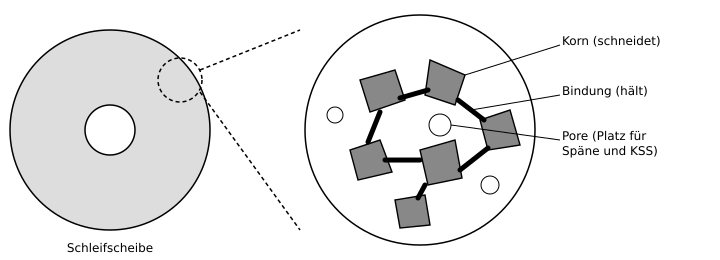

# 3 Schleifmittel und Abrichten

Lernziel · 3 Einheiten

Du erklärst, woraus eine Schleifscheibe besteht und welches Korn zu welchem Werkstoff passt. Du liest eine Scheibenbezeichnung und weißt, warum und wie abgerichtet wird. Hier hast du einen **Vorsprung**: Diamant und CBN kennst du aus der Werkzeug-Seite. Jetzt verbindest du das mit der Maschine.

Deine Brücke

Bei EHWA hast du gefragt: „Welche Scheibe passt zu deinem Prozess?“ Bei Okamoto fragst du: „Welche Maschine bringt diese Scheibe zur Höchstleistung?“ Kunden lieben Verkäufer, die beide Seiten verstehen.

Was du schon weißt · Aufgabe 3.1

Schreib fünf Dinge auf, die du aus deiner Zeit bei EHWA über CBN- und Diamantscheiben weißt, z. B. Bindungen, Einsatzgebiete und typische Kundenprobleme.

[[LINIEN 5]]

## 3.1 Aufbau einer Schleifscheibe

Eine Schleifscheibe besteht aus drei Dingen:

- **Korn:** Das Korn schneidet.
- **Bindung:** Die Bindung hält das Korn fest, aber nur so lange, bis es stumpf ist.
- **Poren:** Die Poren nehmen Späne auf und bringen Kühlschmierstoff in die Schleifzone.

## 3.2 Die vier Kornarten

| Korn | Härte | Typische Werkstoffe | Hinweis |
|---|---|---|---|
| **Korund** (Al₂O₃), auch Edel- und Sinterkorund | hart | Stahl weich und gehärtet | der Klassiker auf Flachschleifmaschinen |
| **Siliziumkarbid** (SiC) | härter | Grauguss, NE-Metalle, Keramik, Vorschliff Hartmetall | spröder als Korund |
| **CBN** (kubisches Bornitrid) | nach Diamant das zweithärteste | gehärtete Stähle, HSS, Superlegierungen | sehr lange Standzeit, hohe Schnittgeschwindigkeiten möglich |
| **Diamant** | am härtesten | Hartmetall, Keramik, Glas, Silizium | **nicht für Stahl**, weil sich der Kohlenstoff des Diamanten bei Hitze im Eisen löst |

Merksatz

**Korund und CBN für Stahl, SiC und Diamant für alles, was kein Stahl ist.** Diamant schleift kein Eisen, weil sich der Diamant-Kohlenstoff bei der Hitze in der Schleifzone im Eisen löst.

[[LINIEN 3]]

## 3.3 Scheibenbezeichnung lesen

**Konventionelle Scheibe** (Korund/SiC), Beispiel: **1 – 355 × 50 × 127 – A 60 K 7 V – 35 m/s**

| Teil | Bedeutung |
|---|---|
| 1 | Form: gerade Scheibe |
| 355 × 50 × 127 | Außendurchmesser × Breite × Bohrung in mm |
| A | Kornart: Korund (C wäre SiC) |
| 60 | Körnung: je größer die Zahl, desto feiner das Korn |
| K | Härte, also wie fest die Bindung das Korn hält: A = sehr weich … Z = sehr hart |
| 7 | Gefüge: je größer die Zahl, desto offener die Scheibe und desto mehr Poren |
| V | Bindung: keramisch (B = Kunstharz) |
| 35 m/s | höchste zulässige Umfangsgeschwindigkeit, **nie überschreiten** |

**CBN- und Diamantscheibe**, Beispiel: **B126 – C100 – V**

- **B** = CBN, **D** = Diamant. Die Zahl ist die Korngröße in µm, also B126 ≈ 126 µm.
- **C100** = Konzentration. 100 entspricht 4,4 Karat Schleifmittel pro cm³ Belag.
- Bindung: **B** Kunstharz, **V** keramisch, **M** metallisch, **G** galvanisch.

Faustregel Härte

**Harter Werkstoff, weichere Scheibe.** Auf hartem Stahl werden die Körner schnell stumpf. Eine weichere Bindung lässt sie rechtzeitig ausbrechen, und frische, scharfe Körner kommen nach. Ist die Scheibe zu hart, „glänzt“ sie zu, reibt statt zu schneiden und erzeugt Schleifbrand.

[[LINIEN 3]]

## 3.4 Abrichten

Abrichten bringt die Scheibe wieder in Form und macht sie wieder scharf. Es hat drei Ziele:

1. **Rundlauf:** Die Scheibe läuft wieder rund.
2. **Profil:** Die Scheibe bekommt eine Form, z. B. einen Radius zum Profilschleifen.
3. **Schärfe:** Stumpfe Körner und zugesetzte Poren werden entfernt.

| Abrichtwerkzeug | Einsatz |
|---|---|
| Einkorn-Diamant | einfach und günstig, für gerade Scheiben auf kleinen Maschinen |
| Vielkorn-Diamant, Fliese | flächiger, verschleißt gleichmäßiger |
| Diamant-Abrichtrolle (rotierend) | Serie und Profile, schnell und wiederholgenau |
| Schärfstein | bei CBN und Diamant: legt die Körner nach dem Profilieren wieder frei |

Moderne Maschinen richten **automatisch** ab. Danach **kompensiert** die Steuerung: Sie weiß, um wie viel die Scheibe kleiner geworden ist, und stellt entsprechend nach. Okamoto nennt das programmierbares Abrichten mit Abrichtkompensation (z. B. bei der ACC-SA1-Reihe).

## 3.5 Wärme: der Feind der Präzision

Beim Schleifen wird fast die gesamte Energie zu **Wärme**. Zu viel Wärme führt zu **Schleifbrand** (Anlauffarben, weiche Randzone), **Schleifrissen** und **Maßfehlern**. Gegenmittel sind eine scharfe Scheibe, passende Bindungshärte, genug Kühlschmierstoff und eine nicht zu große Zustellung. Mehr dazu in Kapitel 6.

Rechnen · Aufgaben 3.2 und 3.3

**3.2** Eine neue Scheibe hat Ø 355 mm. Bei jedem Abrichten werden radial 0,02 mm abgetragen. Wie oft kannst du abrichten, bis die Scheibe auf Ø 300 mm verbraucht ist? Achtung: Radial und Durchmesser sind nicht dasselbe.

**3.3** Eine CBN-Scheibe hat die Bezeichnung **B91 C125**. Wie groß ist das Korn ungefähr? Wie viel Karat CBN sind in 1 cm³ Belag? Rechne mit 4,4 ct/cm³ bei C100.

[[KARO 45]]

Erst schätzen, dann prüfen · Aufgabe 3.4

Ein Kunde schleift gehärtete Platten mit einer sehr harten Korundscheibe (Härte P). Die Oberfläche zeigt bräunliche Flecken. Vermute: **Was ist passiert und was würdest du zuerst ändern?** Prüfe deine Vermutung mit der Faustregel in 3.3 und mit 3.5.

[[LINIEN 3]]

Laut sprechen · Aufgabe 3.5 (60 Sekunden)

Ein Kunde will Hartmetall-Stempel auf seiner neuen Flachschleifmaschine schleifen und fragt: „Geht das mit der Korundscheibe, die wir für Stahl haben?“ Antworte fachlich richtig und schlag vor, wer ihm bei der Scheibe hilft.

Fachbegriffe Deutsch – Englisch

| Deutsch | Englisch | Deutsch | Englisch |
|---|---|---|---|
| Schleifscheibe | grinding wheel | Abrichten | dressing |
| Korn | grain / grit | Schärfen | sharpening / conditioning |
| Bindung | bond | Abrichtrolle | dressing roll |
| Körnung | grit size | Schleifbrand | grinding burn |
| Korund | aluminium oxide | Kühlschmierstoff | coolant |

Kurztest Kapitel 3

1. Was sind die drei Bestandteile einer Schleifscheibe und welche Aufgabe hat jeder?
2. Warum schleift man Stahl nicht mit Diamant?
3. Was bedeutet in „A 60 K 7 V“ das „K“?
4. Was bedeutet „D46“?
5. Nenne die drei Ziele des Abrichtens.
6. Warum braucht eine Maschine nach dem Abrichten eine Kompensation?

[[LINIEN 7]]

Wiederholen am: ________ (morgen) · ________ (in 1 Woche) · ________ (in 1 Monat)
