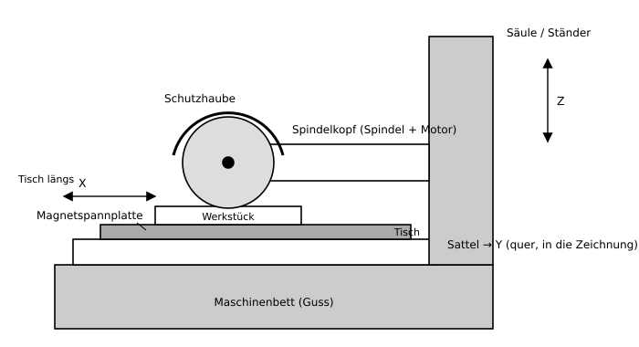
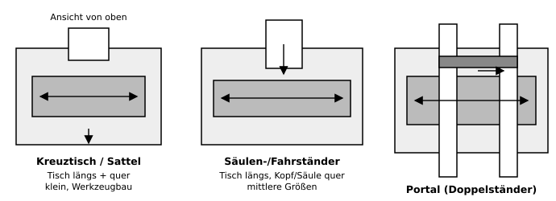

# 4 Die Flachschleifmaschine von innen

Lernziel · 4 Einheiten

Du skizzierst eine Flachschleifmaschine aus dem Kopf und benennst Achsen und Baugruppen. Du kennst die drei Bauformen und weißt, warum Guss, Führungen und Temperatur über die Genauigkeit entscheiden. Damit verstehst du, **womit Hersteller ihre Maschinen verkaufen**.

Was der Kunde eigentlich kauft

Ein Kunde kauft keine „Maschine mit 600 × 400 mm“. Er kauft die Sicherheit, dass sein Teil morgen, nächstes Jahr und in zehn Jahren noch die 0,003 mm schafft. Diese Sicherheit steckt im **Bett, in den Führungen, in der Spindel und in der Temperatur**.

## 4.1 Aufbau und Achsen

| Achse | Bewegung | Typische Ausführung |
|---|---|---|
| **X** | Tisch fährt **längs** hin und her (Pendelhub) | hydraulisch oder Servomotor |
| **Y** | **Querbewegung**, Schritt nach jedem Hub | Sattel oder Säule, Servomotor |
| **Z** | **Zustellung**, Spindelkopf fährt senkrecht | Servomotor mit sehr feiner Auflösung (µm) |

Zeichnen · Aufgabe 4.1

Zeichne die Maschine von oben aus dem Kopf **ohne hinzusehen**. Beschrifte Bett, Tisch, Magnetspannplatte, Säule, Spindelkopf, Scheibe und die Achsen X, Y, Z. Vergleiche erst danach mit der Abbildung und ergänze, was fehlt.

[[FELD 70]]

## 4.2 Die drei Bauformen

| Bauform | Wie bewegt sich was? | Größe | Okamoto (Beispiele) |
|---|---|---|---|
| **Kreuztisch / Sattel** | Tisch fährt längs, Sattel darunter quer, Kopf nur auf und ab | klein bis mittel, Werkzeugbau | ACC-GX, ACC-SA1 („Saddle Type“) |
| **Säulen-/Fahrständer** | Tisch fährt nur längs, Säule oder Kopf fährt quer | mittel, schwere Teile | ACC-Column-Reihen |
| **Portal (Doppelständer)** | Tisch fährt längs unter einer Brücke, Kopf fährt auf der Brücke quer | groß: 2–4 m Schleiflänge | ACC-CHNC, ACC-CHiQ |

**Warum das wichtig ist:** Beim Kreuztisch fahren schwere Teile in zwei Richtungen mit. Das ist gut bei kleinen Teilen, wird bei schweren Teilen aber kritisch. Säule und Portal tragen schwere Teile besser, weil der Tisch nur in eine Richtung fährt.

**Typenschlüssel:** Bei Okamoto steckt die Arbeitsfläche oft im Namen. Die **ACC-64GX** hat eine Schleiffläche von **600 × 400 mm**. Die ACC-CA-iQ-Reihe geht von **600 bis 1000 mm** Schleiflänge, die Portalreihe ACC-CHNC von **2000 bis 4000 mm**.

## 4.3 Die Baugruppen und ihre Verkaufsargumente

| Baugruppe | Worauf es ankommt | Argument im Gespräch |
|---|---|---|
| **Bett und Ständer** | Guss (Okamoto nennt Meehanite-Guss) dämpft Schwingungen, schwer und verrippt | „Masse und Dämpfung bedeuten weniger Rattermarken.“ |
| **Führungen** | **Doppel-V-Führungen** in Längs- und Querrichtung (z. B. GX-Reihe). Alternativen sind Flach-V-, Linear- und hydrostatische Führungen. | „Die Doppel-V-Führung zentriert sich selbst und führt den Tisch genau.“ |
| **Tischantrieb** | hydraulisch: schnelle Umkehr, robust. Servo: programmierbar, ruhig, kein Hydrauliköl-Wärmeeintrag. | Wer viele kurze Hübe fährt, will eine schnelle Umkehr. Wer Profile fährt, will eine programmierbare Achse. |
| **Spindel** | Leistung, Drehzahlbereich, Lagerung. Ein Beispiel: 7,5 kW bei 500–2500 1/min (ACC-84CA-iQ) | Die Drehzahl muss zur Scheibe passen (Kapitel 6). |
| **Spannen** | Magnetspannplatte, für nicht magnetische Teile Vakuum oder Vorrichtung | Ist das Teil magnetisch? Diese Frage gehört in jede Bedarfsanalyse. |
| **Kühlschmierstoff (KSS)** | Emulsion oder Öl, Filtration (Papierband, Magnetabscheider). Okamoto bietet z. B. ein Feinblasen-System (Grind-Bix). | „Sauberer, kühler KSS gibt eine bessere Oberfläche und weniger Brand.“ |
| **Temperatur** | Öltemperatur-Regelung, Kühlung von Hydraulik und Spindel | „Eine konstante Temperatur bedeutet ein konstantes Maß, auch nach drei Stunden.“ |

Merksatz

**Genauigkeit = Steifigkeit + Dämpfung + konstante Temperatur.** Das Bett dämpft, die Führungen bestimmen die Bahn, und die Temperatur entscheidet, ob das Maß über den Tag hält.

[[LINIEN 3]]

## 4.4 Wärme dehnt alles: die wichtigste Formel dieses Kapitels

Δl = α · l · ΔT

- Δl ist die Längenänderung in mm, l die Länge in mm, ΔT die Temperaturänderung in K (1 K = 1 °C Unterschied).
- α ist der Ausdehnungskoeffizient. Für **Stahl gilt etwa 11,5 · 10⁻⁶ 1/K**, für **Gusseisen etwa 10 · 10⁻⁶ 1/K**.

**Beispiel:** Eine Stahlplatte von 500 mm erwärmt sich beim Schleifen um 3 K.
Δl = 11,5 · 10⁻⁶ · 500 mm · 3 = 0,01725 mm ≈ **17 µm**.
Das ist mehr als das Fünffache einer Ebenheitstoleranz von 0,003 mm.

Erst schätzen, dann prüfen · Aufgabe 4.2

Ein Kunde sagt: „Morgens sind die ersten Teile immer ein paar µ daneben, ab 10 Uhr passt es.“ Was vermutest du als Ursache? Welche Ausstattung der Maschine hilft dagegen? Prüfe deine Antwort mit 4.3 und 4.4.

[[LINIEN 3]]

Rechnen · Aufgaben 4.3 bis 4.5

**4.3** Ein Maschinentisch aus Gusseisen ist 1000 mm lang und erwärmt sich um 2 K. Um wie viele µm wird er länger?

**4.4** Eine Stahlleiste von 300 mm darf sich höchstens um 5 µm ändern. Welche Temperaturänderung ΔT ist erlaubt? Stell dazu die Formel nach ΔT um.

**4.5** Die Halle hat morgens 17 °C und nachmittags 23 °C. Wie stark ändert sich eine Stahlplatte von 600 mm? Was bedeutet das für deine Empfehlung an den Kunden (Klimatisierung, Aufwärmprogramm)?

[[KARO 55]]

Transfer · Aufgabe 4.6

Ein Lohnschleifer in Bayern schleift Platten bis **1500 × 700 mm**, bis 800 kg schwer. Er fragt nach einer „ACC-CA-iQ“, weil ein Kollege so eine hat.

a) Passt die Baureihe? Begründe es mit den Angaben in 4.2.

b) Welche Bauform würdest du prüfen und warum?

c) Welche drei Fragen stellst du ihm noch?

[[LINIEN 7]]

Laut sprechen · Aufgabe 4.7 (90 Sekunden)

Ein Kunde vergleicht dich mit einem günstigeren Anbieter: „Die sehen doch alle gleich aus.“ Erkläre ihm in 90 Sekunden, **worauf er unter dem Blech achten sollte**: Guss, Führungen, Temperatur. Verwende das Beispiel mit den 17 µm.

Fachbegriffe Deutsch – Englisch

| Deutsch | Englisch | Deutsch | Englisch |
|---|---|---|---|
| Maschinenbett | machine base / bed | Spindelkopf | wheelhead |
| Führung | slideway / guideway | Magnetspannplatte | magnetic chuck |
| Sattel / Kreuztisch | saddle | Zustellung | infeed / downfeed |
| Säule, Ständer | column | Wärmedehnung | thermal expansion |
| Querzustellung | cross feed | Schwingungsdämpfung | vibration damping |

Kurztest Kapitel 4

1. Welche Achse ist bei der Flachschleifmaschine die Zustellung?
2. Nenne die drei Bauformen und je einen typischen Einsatz.
3. Wofür steht „64“ in ACC-64GX?
4. Nenne zwei Vorteile eines hydraulischen und zwei Vorteile eines Servo-Tischantriebs.
5. Wie viele µm dehnt sich 1 m Stahl bei 1 K ungefähr?
6. Warum ist ein Gussbett besser als eine Schweißkonstruktion?

[[LINIEN 7]]

Wiederholen am: ________ (morgen) · ________ (in 1 Woche) · ________ (in 1 Monat)
