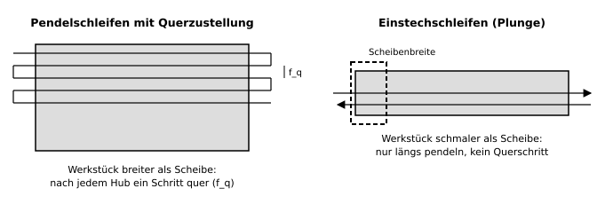

# 5 Steuerung und Automatisierung

Lernziel · 3 Einheiten

Du unterscheidest manuelle, NC- und CNC-Maschinen und erklärst die wichtigsten Schleifzyklen. Du weißt, welche Automatisierung Kunden heute fragen und warum: weniger Bediener, mehr Spindelstunden.

Ein Satz, den du oft hören wirst

„Unsere Schleifer gehen in drei Jahren in Rente. Die Jungen wollen nicht an Handrädern stehen.“ Die Steuerung ist deshalb nicht nur Technik. Für viele Kunden ist sie die Antwort auf den **Fachkräftemangel**.

## 5.1 Die Steuerungsstufen

| Stufe | Was der Bediener tut | Wann sinnvoll | Okamoto (Beispiele) |
|---|---|---|---|
| **Manuell** | stellt alles per Handrad zu | Einzelteile, Ausbildung, kleines Budget | kleine Handmaschinen (z. B. 350 × 150 mm) |
| **Halbautomatisch / 1-Achs-NC** | gibt Aufmaß, Zustellung und Ausfunkhübe ein, Zyklus läuft automatisch | Werkzeugbau, wiederkehrende Platten | ACC-SA1 (MDI-Steuerung), ACC-GX |
| **CNC (2–3 Achsen)** | wählt ein Programm oder gibt es im Dialog ein, auch Profile, Nuten, Seiten | Profile, Serie, komplexe Teile | ACC-CA-iQ, ACC-CHiQ, Fanuc-Steuerung |
| **CNC + Automation** | belädt den Speicher und überwacht | Serie, mannlose Schicht | Zellen mit Roboter oder Palette (projektbezogen) |

Okamoto setzt bei CNC auf **Fanuc-Steuerungen** mit drei Hauptachsen und **bis zu fünf Hilfsachsen**, z. B. für Schwenkabrichter oder Teilapparate. Dazu kommt die eigene **iQ-Dialogsoftware**: Der Bediener gibt Werte in Masken ein und muss keinen G-Code schreiben.

Merksatz

**Je mehr Varianten und je weniger Fachkräfte, desto mehr Steuerung.** Mit einer Dialogsteuerung kann auch ein Bediener ohne CNC-Programmierkenntnisse komplexe Zyklen fahren. Das ist ein starkes Verkaufsargument.

[[LINIEN 3]]

## 5.2 Die wichtigsten Zyklen

- **Pendelschleifen mit Querzustellung:** Der Tisch pendelt in X. Nach jedem Hub geht die Scheibe um f_q quer. Ist die Fläche einmal überfahren, stellt Z um ae zu. Das passt für Flächen, die **breiter als die Scheibe** sind.
- **Einstechschleifen (Plunge):** Das Werkstück ist **schmaler als die Scheibe**. Dann wird nur pendelnd zugestellt, ohne Querschritte. Das ist viel schneller.
- **Shift-Plunge** (Okamoto ACC-SA1): Die Scheibe sticht ein, versetzt quer um etwas weniger als ihre Breite und sticht wieder ein. So geht das Schruppen breiter Flächen schnell. Geschlichtet wird danach mit Pendeln.
- **Ausfunken (spark-out):** Am Ende fährt die Maschine einige Hübe **ohne Zustellung**, bei Okamoto einstellbar von 0 bis 5. Die Scheibe hat sich unter der Schleifkraft etwas abgedrängt. Beim Ausfunken federt alles zurück und das Restmaterial wird abgetragen. Das verbessert Maß und Ebenheit.
- **Weitere Zyklen bei CNC:** Seiten-, Nut- und Profilschleifen sowie **Mehrpositionsschleifen**, bei dem mehrere Teile an verschiedenen Positionen in einem Programm geschliffen werden.
- **Automatisches Abrichten mit Kompensation**, z. B. mit einem Klappabrichter. Er wird zwischen Schruppen und Schlichten eingesetzt.

Zeichnen · Aufgabe 5.1

Zeichne von oben eine Platte von 120 mm Breite. Zeichne darauf die Einstichpositionen eines Shift-Plunge-Zyklus mit einer Scheibe von 50 mm Breite und 10 mm Überlappung. Die Rechnung dazu steht in 5.2.

[[FELD 50]]

Rechnen · Aufgabe 5.2 – Shift-Plunge planen

Scheibenbreite b = 50 mm, gewünschte Überlappung 10 mm, also Versatz = 50 − 10 = 40 mm.
Werkstückbreite B = 120 mm.

Anzahl Einstiche = (B − b) / Versatz + 1, aufgerundet.

a) Rechne die Anzahl der Einstiche aus. Prüfe mit einer Skizze, ob die ganze Breite abgedeckt ist.

b) Wie viele Einstiche brauchst du bei B = 200 mm?

[[KARO 35]]

Erst schätzen, dann prüfen · Aufgabe 5.3

Ein Bediener stellt das Ausfunken auf 0, um Zeit zu sparen. Vermute, was mit **Maß** und **Ebenheit** passiert. Begründe es mit der Abdrängung. Prüfe danach mit 5.2.

[[LINIEN 3]]

## 5.3 Automatisierung: Wonach Kunden fragen

| Kundenwunsch | Lösung (allgemein) | Deine Frage im Gespräch |
|---|---|---|
| „Die Maschine soll nachts laufen.“ | Roboter- oder Palettenbeladung, Werkstückspeicher | Wie viele Teile pro Schicht? Wie werden sie gespannt? |
| „Ich will nicht ständig messen.“ | Messtaster in der Maschine, Nachmessen und Korrigieren | Welche Toleranz, und welches Merkmal ist kritisch? |
| „Rüsten dauert zu lange.“ | Nullpunktspannsystem, gespeicherte Programme | Wie viele Varianten, wie oft wird umgerüstet? |
| „Die Scheibe verschleißt unterschiedlich.“ | automatisches Abrichten mit Kompensation | Welche Scheibe, wie oft wird heute abgerichtet? |

Transfer · Aufgabe 5.4

Ein Werkzeugbauer mit 12 Mitarbeitern hat eine alte Handmaschine. Er schleift Platten in Losgrößen von 1 bis 5 Stück. Sein Schleifer geht in zwei Jahren in Rente.

a) Welche Steuerungsstufe empfiehlst du? Begründe deine Wahl.

b) Lohnt sich ein Roboter für ihn? Begründe auch das.

[[LINIEN 6]]

Laut sprechen · Aufgabe 5.5 (60 Sekunden)

Erkläre einem Geschäftsführer, der kein Techniker ist, den Nutzen einer **Dialogsteuerung**. Verwende ein Bild aus dem Alltag, z. B. ein Navi statt einer Landkarte.

Fachbegriffe Deutsch – Englisch

| Deutsch | Englisch | Deutsch | Englisch |
|---|---|---|---|
| Ausfunken | spark-out | Dialogsteuerung | conversational control |
| Pendelhub | reciprocating stroke | Beladung | loading |
| Querschritt | cross feed increment | Messtaster | touch probe |
| Abdrängung | deflection | Rüstzeit | setup time |
| Klappabrichter | folding dresser | mannlose Schicht | unmanned / lights-out shift |

Kurztest Kapitel 5

1. Wann wählt man Einstechschleifen statt Pendelschleifen?
2. Was passiert beim Ausfunken und warum verbessert es das Ergebnis?
3. Erkläre den Shift-Plunge-Zyklus in einem Satz.
4. Welche Steuerung nutzt Okamoto bei CNC-Maschinen, und was ist iQ?
5. Nenne drei Automatisierungswünsche von Kunden.

[[LINIEN 7]]

Wiederholen am: ________ (morgen) · ________ (in 1 Woche) · ________ (in 1 Monat)
