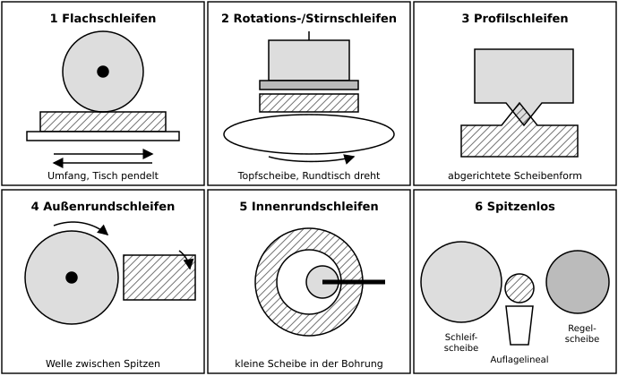

# Wandblatt 1 – Schleiftechnik auf einen Blick

| Frage des Kunden | Deine Gedankenkette |
|---|---|
| Ebene Fläche, gehärtet, µm-genau? | Flachschleifen: Kreuztisch → Säule → Portal, je nach Größe und Gewicht |
| Welle oder Bohrung, IT5–IT7? | Außenrund (OGM) / Innenrund (IGM) |
| Form, Radius, Nut? | Profilschleifen, CNC mit Profilabrichten |
| Stahl oder Hartmetall? | Korund/CBN für Stahl, Diamant/SiC für Hartmetall und Keramik |
| Maß schwankt am Vormittag? | Wärme: Temperaturregelung, Warmlaufen, KSS-Kühlung |
| Bediener geht in Rente? | Dialogsteuerung (iQ), gespeicherte Programme |
| Taktzeit zu hoch? | Schlichten prüfen, Mehrpositionsschleifen, Aufmaß senken |

v_c = π · d_s · n_s / 60 000  ·  q_s = v_c / v_w  ·  Q'_w = a_e · v_w  ·  Δl = α · l · ΔT

Die drei Sätze, die immer passen

1. „Schleifen ist der letzte Schritt. Hier entscheidet sich, ob das Teil gut ist.“
2. „Genauigkeit = Steifigkeit + Dämpfung + konstante Temperatur.“
3. „Rechnen wir das mit Ihrem Teil durch.“

